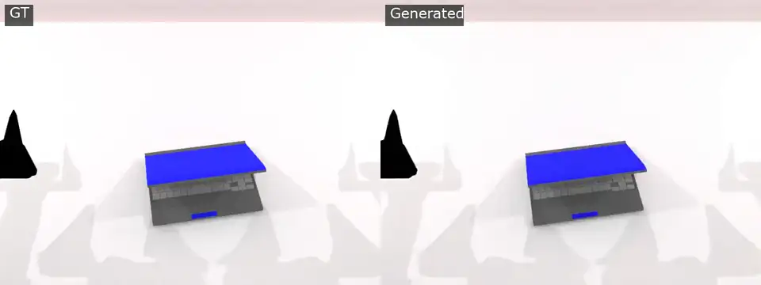
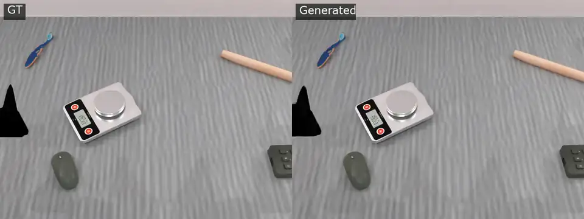
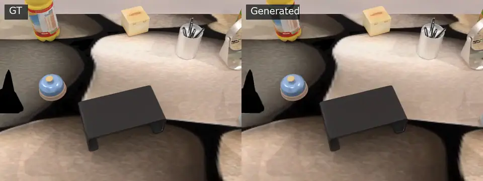
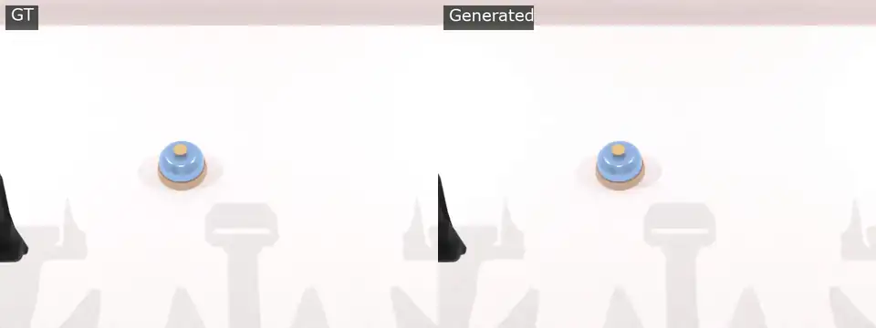

<div align="center">

# GILWM

### Structure-Conditioned Video World Modeling for Robot Manipulation

[Paper (Coming Soon)](#citation) · [Model](https://huggingface.co/kurisu0306/GILWM) · [Code](https://github.com/GILWM/GILWM)

</div>

GILWM is a structure-conditioned video world model for robot manipulation and embodied interaction. Given an initial RGB frame and a language instruction, it predicts how the scene may evolve while using object-level structure to preserve geometry, identity, pose, and spatial relationships over time.

GILWM builds on the 2B-parameter [NVIDIA Cosmos Predict2.5](https://github.com/nvidia-cosmos/cosmos-predict2.5) Video2World backbone. It injects first-frame structure features from SAM 3 and SAM 3D Objects through learned, zero-gated cross-attention adapters.


## News

- **September 2026:** Code repository and model card prepared for release.
- **Coming soon:** GILWM technical report.

## Qualitative results

These examples are selected from our self-evaluation on the Balanced50 benchmark subset. Each animation shows the ground-truth video on the left and the GILWM prediction on the right. They are qualitative examples rather than official leaderboard measurements. Click an animation to open the MP4.

<table>
  <tr>
    <td width="50%" align="center"><b>Lift the compact black laptop</b></td>
    <td width="50%" align="center"><b>Place the mouse onto the electronic scale</b></td>
  </tr>
  <tr>
    <td><a href="assets/demos/gilwm_episode17.mp4"></a></td>
    <td><a href="assets/demos/gilwm_episode34.mp4"></a></td>
  </tr>
  <tr>
    <td width="50%" align="center"><b>Place the blue bell onto the black stand</b></td>
    <td width="50%" align="center"><b>Press the center of the blue bell</b></td>
  </tr>
  <tr>
    <td><a href="assets/demos/gilwm_episode35.mp4"></a></td>
    <td><a href="assets/demos/gilwm_episode6.mp4"></a></td>
  </tr>
</table>

## Model

| Property | Value |
| --- | --- |
| Task | Structure-conditioned image-to-video prediction |
| Domain | Robot manipulation and embodied interaction |
| Backbone | Cosmos Predict2.5 2B Video2World |
| Training clip / AR chunk | 93 frames |
| Output resolution | 640 × 480 |
| Output length | Configurable through autoregressive chunks |
| Checkpoint | Consolidated bf16 PyTorch EMA state dict |
| Model file | `model_ema_bf16.pt` |

The release contains one model named **GILWM**. The checkpoint contains inference weights only; optimizer, scheduler, and trainer states are not included. GILWM predicts visual futures and is not a robot-action generator or closed-loop control policy.

Download the checkpoint with the Hugging Face CLI:

```bash
hf auth login
hf download kurisu0306/GILWM model_ema_bf16.pt \
  --local-dir checkpoints/GILWM
```

The expected SHA-256 for `model_ema_bf16.pt` is:

```text
fe29928334732c20241c452e6d4144e5293c2c6db549a604f390ac07a8d1fa67
```

## Installation

Clone this repository and initialize the environment described in the upstream [Cosmos setup guide](docs/setup.md):

```bash
git clone https://github.com/GILWM/GILWM.git
cd GILWM
```

The released GILWM launchers have been validated on Linux with Moore Threads MUSA, `torch_musa`, MCCL, and 80 GB accelerators. The exact MUSA package snapshot is recorded in [`projects/sam3d/configs/cosmos-musa-pip-freeze.txt`](projects/sam3d/configs/cosmos-musa-pip-freeze.txt). A CUDA or macOS port has not been validated.

In addition to the GILWM checkpoint, inference requires the compatible Cosmos Predict2.5 text encoder and VAE plus SAM 3, SAM 3D Objects, DINOv2, and MoGe assets used by the structure preprocessing pipeline. These dependencies are distributed under their respective terms.

## Prepare structure conditions

GILWM consumes a fixed-shape `condition.pt` generated from the first frame. Prepare SAM 3 masks and DINO features, generate the SAM 3D Objects sidecars, then merge and validate them:

```bash
python projects/sam3d/scripts/prepare_sam3d_conditions.py \
  --dataset-root "$DATASET_ROOT" \
  --manifest "$DATASET_ROOT/manifest.jsonl" \
  --cache-root "$SAM3D_CACHE_ROOT" \
  --sam3-checkpoint "$SAM3_CHECKPOINT" \
  --dino-repo "$DINOV2_REPO" \
  --teacher-frames 8 \
  --minimum-frames 93 \
  --device musa:0

python projects/sam3d/scripts/merge_sam3d_object_sidecars.py \
  --base-cache-root "$SAM3D_CACHE_ROOT" \
  --sidecar-root "$SAM3D_OBJECTS_ROOT" \
  --output-root "$SAM3D_MERGED_CACHE_ROOT" \
  --overwrite

python projects/sam3d/scripts/validate_sam3d_cache.py \
  "$SAM3D_MERGED_CACHE_ROOT" \
  --require-masks \
  --require-geometry \
  --require-sam3d-objects
```

See the [reproduction guide](docs/release_reproduction.md) for the cache schema, external assets, and runtime layout.

## Inference

Copy the example request and replace the first-frame and `condition.pt` paths:

```bash
cp projects/sam3d/configs/inference.example.json /path/to/gilwm_input.json
```

Configure the MUSA runtime and run one 93-frame inference chunk:

```bash
export COSMOS_PROJECT="$PWD"
export COSMOS_SAM3D_WORKSPACE=/path/to/runtime-workspace
export COSMOS_MUSA_IMAGE=<your-musa-runtime-image>
export GILWM_INFERENCE_JSON=/path/to/gilwm_input.json
export GILWM_INFERENCE_OUTPUT=/path/to/output

bash projects/sam3d/scripts/run_gilwm_inference.sh checkpoints/GILWM
```

If the input image or condition cache is outside the repository and workspace, add its parent directory to `COSMOS_EXTRA_BIND_PATHS` so the container can read it. Longer videos can be generated by setting `enable_autoregressive` in the input JSON and using 93-frame chunks with overlap.

## Training

Training uses manifest-driven video datasets and precomputed structure conditions. Start from the portable environment template:

```bash
cp projects/sam3d/configs/release.env.example .env.gilwm
# Edit paths, runtime image, rendezvous host, and initialization checkpoints.
source .env.gilwm

# Run once per node with NODE_RANK set to 0, 1, 2, ...
bash projects/sam3d/train_v93.sh "$NODE_RANK"
```

The reference setup uses 93 frames at 640 × 480, four nodes with eight devices per node, batch size four per device, AdamW, and a cosine schedule. Exact historical initialization weights and training data are not bundled; changing them starts a different training run. Details are in the [reproduction guide](docs/release_reproduction.md).

## Repository layout

```text
cosmos_predict2/
  _src/predict2/
    datasets/local_datasets/sam3d_video_dataset.py
    models/sam3d_video2world_model.py
    networks/sam3d_conditioned_dit.py
    sam3d/
  experiments/sam3d_world_model.py
projects/sam3d/
  train_v93.sh
  scripts/
  configs/
tests/sam3d/
assets/demos/
```

## License and acknowledgements

This codebase is derived from NVIDIA Cosmos Predict2.5. See [LICENSE](LICENSE) for licensing information. Users must also comply with the licenses and terms for Cosmos Predict2.5, SAM 3, SAM 3D Objects, DINOv2, MoGe, and downloaded assets.

## Citation

The GILWM technical report and BibTeX entry are coming soon.
